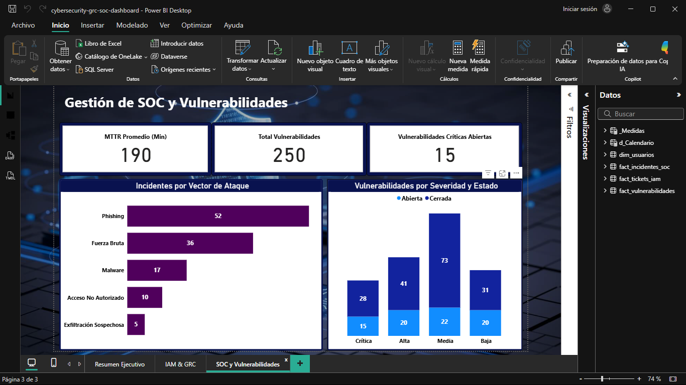
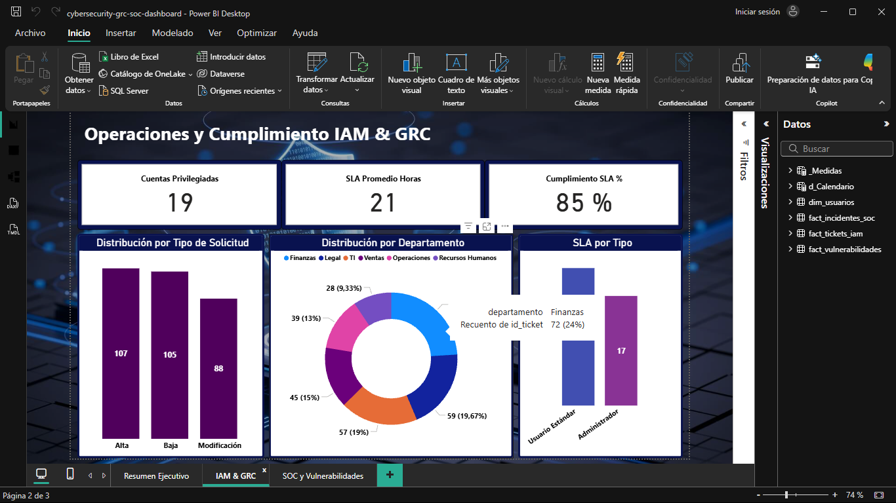
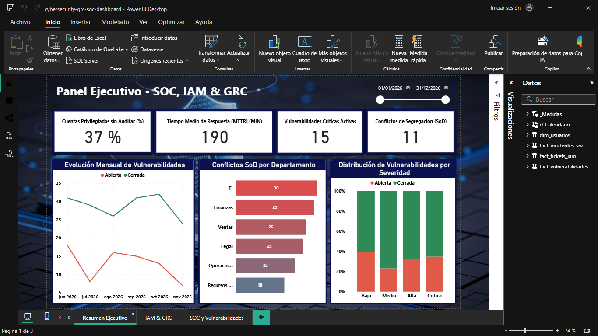

# 🛡️ Executive Cybersecurity Dashboard (SOC, IAM & GRC)

## 📊 Project Overview
High-performance executive dashboard developed in **Power BI**, designed to centralize and monitor critical cybersecurity metrics, Access Management (IAM), Governance, Risk, and Compliance (GRC), and Security Operations (SOC).

The report features an elegant, modern, dark-themed visual identity, structured into three interactive pages optimized for executive decision-making.

---

## 🐍 Dataset Generation (Python Script)
The raw datasets used for this project were dynamically generated using a custom Python script (`script python.py`) located inside the `datasets/` folder. 
* **Purpose:** It populates realistic relational data simulating organizational users, IAM tickets, SOC incidents, and vulnerability scans.
* **Outputs:** 
  * `dim_usuarios.csv` (User dimension and attributes)
  * `fact_tickets_iam.csv` (IAM requests and SLA metrics)
  * `fact_incidentes_soc.csv` (SOC incidents and attack vectors)
  * `fact_vulnerabilidades.csv` (Vulnerability assessments and severities)

---

## 🏗️ Architecture & Data Modeling
The data model follows a **Star Schema** architecture to ensure optimal performance and efficient cross-filtering:
* **`fact_tickets_iam`**: Access requests, provisioning, and resolution tracking.
* **`fact_incidentes_soc`**: Security incidents, response times (MTTR), and attack vectors.
* **`fact_vulnerabilidades`**: Technical vulnerabilities, severity levels, and remediation status.
* **`d_Calendario`**: Date dimension supporting temporal analysis and dynamic filtering.

---

## 🔄 Power Query Transformations
**Power Query** was leveraged as a core pillar for data cleaning and preparation:
* Handling data types, unifying date formats, and treating null values.
* Creating custom conditional columns (such as mapping boolean user types to readable user roles).
* Optimizing data transformations to ensure a lean and robust semantic model.

---

## 📑 Report Pages
1. **Executive Summary:** High-level overview of the security posture, highlighting un-audited privileged accounts, MTTR, critical active vulnerabilities, and Segregation of Duties (SoD) conflicts.
2. **IAM & GRC:** Detailed analysis of request volumes, department distributions, SLA compliance, and user-type metrics.
3. **SOC & Vulnerabilities:** Operational control of incident response times, attack vector breakdowns (Phishing, Brute Force, etc.), and vulnerability severities.

---

## 🖼️ Visualizations & Screenshots

| Executive Summary | IAM & GRC | SOC & Vulnerabilities |
| :---: | :---: | :---: |
|  |  |  |

---

## 🛠️ Tech Stack
* **Power BI Desktop**
* **Power Query (M)**
* **DAX (Data Analysis Expressions)**
* **Python (Data Generation)**
* **Dimensional Modeling (Star Schema)**